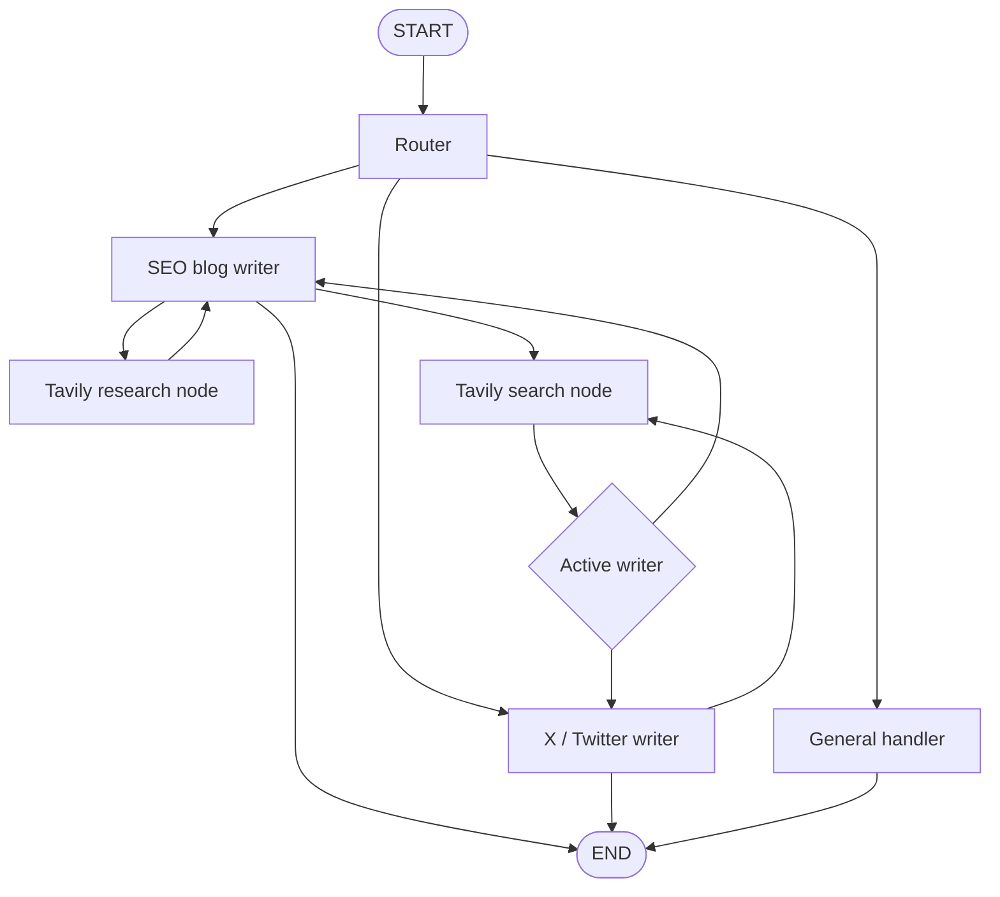

# Smart AI Content Assistant

A notebook-based LangGraph application that routes a user's request to an SEO blog writer, an X/Twitter writer, or a general conversation handler. The writers decide whether to use Tavily tools, receive their results through graph loops, and produce content with conversation context.

The implementation is in [`notebook/ai-content-assistant.ipynb`](notebook/ai-content-assistant.ipynb), with separate sections for prompts, state definitions, nodes, routing functions, and tests.

## Features

- LLM-based routing with a validated destination and brief routing explanation.
- SEO blogs with headings, a meta description, conclusion, CTA (Call to Action), and references.
- X posts prompted to stay under 280 characters, using relevant emojis and hashtags where useful.
- Tavily Research for detailed analysis and Tavily basic search for focused web lookups.
- Tool-selection explanations supplied by the writer in `selection_reason` and saved in state.
- Parallel tool dispatch using LangGraph `Send`.
- Conversation persistence using an in-memory checkpointer and a thread ID.
- Mermaid graph visualization and optional LangSmith tracing.

## Architecture



The graph registers the router as `router_agent_node`, using the Python function `router_node`. Its destinations are `seo-agent-writer-node`, `x-blog-agent-writer-node`, and `general-agent-writer-node`.

The router selects one writer per user request. A writer returns an `AIMessage`: either a request containing `tool_calls`, or the finished response. Tool nodes execute pending calls and return `ToolMessage` results matched by `tool_call_id`. The graph then returns control to the relevant writer. The general handler uses the LLM without tools.

When the SEO writer requests research and search together, `Send` dispatches both branches. The message and source reducers merge their results before the writer continues. The shared search node uses the active `route` to return to the SEO or X writer.

## Repository contents

- `notebook/ai-content-assistant.ipynb`: implementation, graph visualization, and examples.
- `requirements.txt`: Python dependencies, with the main framework versions pinned.
- `.env.example`: configuration template containing placeholders only.
- `.gitignore`: excludes local credentials, virtual environments, and notebook checkpoints.

## Setup

Python 3.12 is the version used during development. Create an isolated environment from the repository root:

```bash
python3 -m venv .venv
source .venv/bin/activate
python -m pip install -r requirements.txt
cp .env.example .env
```

Open the notebook in PyCharm or another Jupyter-compatible editor and select this environment as the notebook kernel. To use JupyterLab separately:

```bash
python -m pip install jupyterlab
jupyter lab
```

Start the kernel in the repository root or its `notebook` directory. The installation and environment cells handle both locations. Restart the kernel if installation changes packages already imported.

## Configuration

Edit your local `.env`:

```dotenv
OPENAI_API_KEY=your_openai_api_key
TAVILY_API_KEY=your_tavily_api_key
LANGSMITH_API_KEY=your_langsmith_api_key
LANGSMITH_TRACING=true
LANGSMITH_PROJECT=smart-ai-content-assistant
LANGSMITH_ENDPOINT=https://api.smith.langchain.com
```

OpenAI and Tavily keys are required by the setup cell. LangSmith is optional: leave its key empty and set `LANGSMITH_TRACING=false` if tracing is not needed. Use the appropriate LangSmith endpoint for your account region; workspace-scoped configuration may also be needed for keys linked to multiple workspaces.

The notebook loads `.env` using `python-dotenv` and does not print credential values. Existing kernel environment variables take precedence, so restart the kernel after changing previously loaded values. The setup cell also clears LangSmith's cached environment lookup so newly loaded tracing settings are recognized.

Keep real credentials in `.env`, which is excluded from Git. `.env.example` contains placeholders and is safe to commit.

## Running the notebook

Run the setup and definition cells in order. Live test cells are separate and invoke external services when run; inspect them before selecting “Run All.”

1. **Step 1 — Setup:** install libraries, load credentials, configure tracing, and initialize `gpt-4o-mini` with temperature zero.
2. **Step 2 — State:** define shared input, route, explanation, output, sources, and messages.
3. **Step 3 — Router:** use a prompt template and structured output to select a writer. Step 3a demonstrates routing.
4. **Step 4 — Tools:** define Tavily Research and basic search. Steps 4a and 4b call the tools directly.
5. **Step 5 — SEO writer:** define its prompt, tool-bound model, writer node, and tool execution nodes. Step 5a demonstrates selecting research, search, or both.
6. **Step 6 — X writer:** define its prompt and writer node, with only search available. Step 6a demonstrates its first decision.
7. **Step 7 — General handler:** answer using conversation history and a model without tools.
8. **Step 8 — Graph:** register nodes, conditional routes, `Send` dispatch, return edges, and display a Mermaid diagram.
9. **Step 9 — Persistence:** compile `graph` with `InMemorySaver`.
10. **Step 10 — Examples:** generate an SEO blog end to end, verify the tool-round limit with mocks in Step 10a, and research Krishnadevaraya's reign in Step 10b.

After running the definition and compilation cells, invoke the graph with a user request:

```python
result = graph.invoke(
    {'user_input': 'Write an SEO blog explaining Python virtual environments.'},
    config={
        'configurable': {'thread_id': 'my-conversation'},
        'recursion_limit': 20,
    },
)
print(result['output'])
```

Reuse the same thread ID for a follow-up:

```python
follow_up = graph.invoke(
    {'user_input': 'What was my previous request?'},
    config={'configurable': {'thread_id': 'my-conversation'}},
)
print(follow_up['output'])
```

Use a different thread ID for an independent conversation. The checkpointer stores state only in the current Python process; restarting the kernel loses that history.

## State and updates

`State` is a `TypedDict` with `user_input`, `route`, `reasoning`, `output`, `sources`, and `messages`.

Nodes return partial updates: fields not returned remain unchanged. `messages` uses `add_messages` to combine conversation messages. `sources` uses a custom reducer that combines and deduplicates URLs, including concurrent updates from parallel tool nodes. Source URLs currently accumulate across turns in the same thread. `reasoning` holds the latest explanation, so tool selection can replace the router's initial explanation.

## Research versus search

`research_tool` starts a Tavily `/research` task with the `pro` model, then polls its request ID. It requests up to four structured findings and returns up to four source records. Findings also retain their supporting reference URLs, so the complete set of cited URLs may exceed four. The research function waits approximately five minutes, with individual HTTP timeouts, before reporting a pending task's ID.

`internet_search_tool` calls Tavily `/search` using `search_depth='basic'` and `topic='general'`. It returns up to four results containing titles, content snippets, and URLs. It does not supply measured SEO keyword volumes or verified X trend data.

The tool nodes preserve citations in tool messages and collect URLs in `State.sources`. Expected tool failures become error `ToolMessage` results so the writer can acknowledge missing evidence.

## Tool-round limits

The SEO writer enforces **two tool-request rounds per user turn** in code. A round means one AI response containing tool calls; it is not a limit of two individual calls. Both tools may execute in the same round. After two rounds, the node switches to the LLM without tools and generates the final response.

The X writer has no custom round limit. Its prompt asks it to avoid redundant searches and stop when sufficient information is available. LangGraph's `recursion_limit` is a separate execution safeguard; exceeding it raises an error rather than producing a final response.

## Tests

The notebook contains live examples and a deterministic limit test:

- Tool-selection examples call OpenAI but do not execute the requested Tavily tools.
- Steps 4a/4b and end-to-end examples can consume Tavily and OpenAI credits.
- Step 10a executes the real graph, tool nodes, and tool functions with mocked LLM and HTTP responses. It prepares three rounds, verifies that both tools execute in the first two rounds, and checks that the third request is not consumed. The graph then produces a final response and reaches `END`.

Routing and parallel merging were also checked using mocked responses during development. Generated articles and source interpretations should be reviewed before publication. The X character limit and SEO formatting are currently prompt instructions, not production output validators.

## LangSmith observability

With tracing enabled before execution, LangGraph, LangChain model calls, and decorated tool calls appear in the configured LangSmith project. Traces include inputs, outputs, timing, errors, and nested execution details. Ordinary assignments and print statements are not individual traces.

Step 10 uses the run name `seo-writer-end-to-end-test`; Step 10b uses `krishnadevaraya-history-research`. Tags and thread IDs help identify runs. The deterministic Step 10a test temporarily disables tracing so synthetic test traffic is not uploaded.

If traces are missing, rerun setup, confirm the project is `smart-ai-content-assistant`, and run a new example. Past runs are not traced retroactively. Check the account endpoint, workspace, UI filters, and API key if delivery still fails.

## Troubleshooting

- **`NameError` for a model, tool, or node:** run the earlier definition cells before graph construction and tests.
- **Missing API key:** edit `.env`, restart the kernel, and rerun setup.
- **Tavily HTTP 400:** inspect the response body. Its research schema accepts `properties` and `required` at the top level and requires descriptions for properties.
- **Research timeout:** use the reported task ID to retrieve the existing research task rather than starting a duplicate.
- **Authentication or rate-limit errors:** verify credentials and provider account limits. Tool-node errors are returned as messages; direct tool tests display exceptions.
- **Mermaid display fails:** `draw_mermaid_png()` uses an external rendering service by default. The graph definition is still available through `graph_preview.get_graph().draw_mermaid()`.

## References

- [LangGraph documentation](https://docs.langchain.com/oss/python/langgraph/overview)
- [Tavily Research API](https://docs.tavily.com/documentation/api-reference/endpoint/research)
- [Tavily Search API](https://docs.tavily.com/documentation/api-reference/endpoint/search)
- [LangSmith tracing with LangGraph](https://docs.langchain.com/langsmith/trace-with-langgraph)
